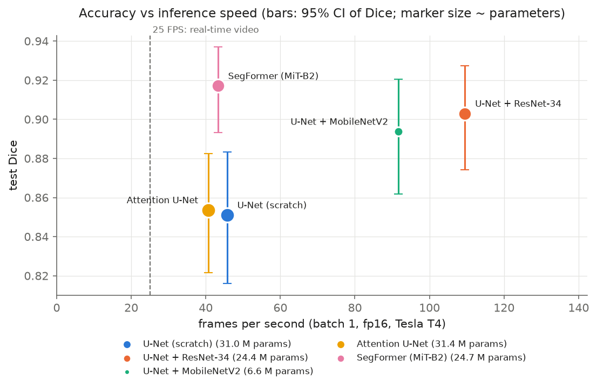
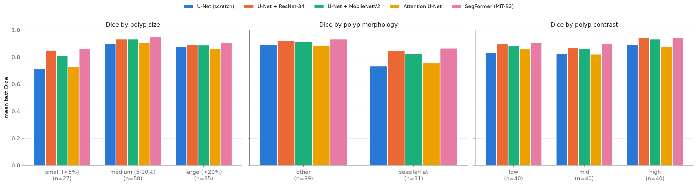
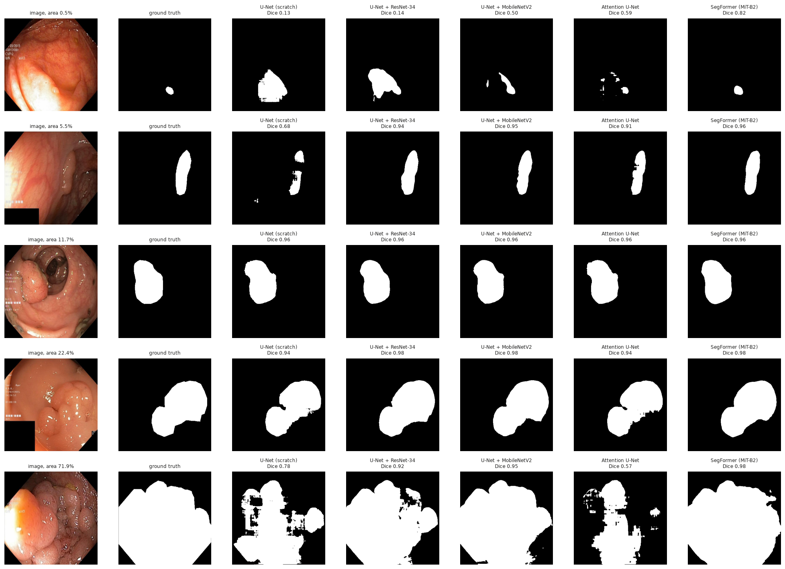

# PolypHunter 🔬
### P13 — Polyp Segmentation in Colonoscopy: U-Net and Its Variants

Pixel-level segmentation of colorectal polyps on **Kvasir-SEG** to support early colorectal-cancer screening.
We go from a U-Net baseline → U-Net with a pretrained ResNet encoder → Attention U-Net / transformer encoder,
measure **Dice** and **IoU**, study the **accuracy vs inference-speed trade-off** for real-time use, and analyse
**failures on small and flat polyps**.

## Models

| Key | Model | Encoder init |
|---|---|---|
| `unet_scratch` | U-Net (Ronneberger et al., 2015) | random |
| `unet_resnet34` | U-Net + ResNet-34 encoder | ImageNet |
| `unet_mobilenetv2` | U-Net + MobileNetV2 encoder (lightweight, real-time reference) | ImageNet |
| `attention_unet` | Attention U-Net (Oktay et al., 2018) | random |
| `segformer_mitb2` | SegFormer, MiT-B2 transformer encoder | ImageNet |

Extras: test-time augmentation (flips), threshold tuned on validation, cross-dataset test on CVC-ClinicDB,
attention-gate visualisation, Kvasir-Sessile labels for flat polyps.

## Report

**[report/REPORT_CVPR.pdf](report/REPORT_CVPR.pdf)**: the project report in the CVPR paper template.
Its LaTeX source is in `report/cvpr/`. Rebuild it, and the Overleaf-ready zip, with `tools/build_cvpr.sh`.
The Markdown drafts it was written from are in `report/sections/`, and they are assembled in `report/REPORT.md`.

## Results

Test set of Kvasir-SEG (120 images, fixed split). Every number comes from `results/summary/results_table.csv`.
FPS is batch 1 at 352×352 on a Kaggle T4 GPU. "Miss rate" is the share of test images with Dice below 0.5.

| Model | Params (M) | Dice | IoU | Dice + TTA | Miss rate | CVC-ClinicDB Dice | FPS fp32 | FPS fp16 | Train time |
|---|---|---|---|---|---|---|---|---|---|
| U-Net (scratch) | 31.0 | 0.851 | 0.774 | 0.863 | 4.2% | 0.750 | 11.6 | 45.7 | 46 min |
| U-Net + ResNet-34 | 24.4 | 0.903 | 0.846 | 0.912 | 3.3% | 0.828 | 44.9 | **109.5** | 9 min |
| U-Net + MobileNetV2 | **6.6** | 0.894 | 0.835 | 0.900 | 5.0% | 0.753 | **86.5** | 91.7 | 8 min |
| Attention U-Net | 31.4 | 0.854 | 0.775 | 0.857 | 5.0% | 0.741 | 10.6 | 40.7 | 54 min |
| **SegFormer (MiT-B2)** | 24.7 | **0.917** | **0.865** | **0.926** | **2.5%** | **0.863** | 56.9 | 43.3 | 12 min |

**Key findings**
- **Pretrained encoders matter most.** ResNet-34, MobileNetV2 and SegFormer all beat the from-scratch U-Net
  significantly (paired bootstrap, p < 0.001). Attention gates add nothing measurable (+0.003 Dice, p = 0.73).
- **SegFormer is the most accurate model**, but its lead over ResNet-34 (+0.014 Dice) is not significant on
  120 test images (p = 0.17).
- **Real time:** in fp16, all five models exceed the 25 FPS of colonoscopy video. In fp32 only ResNet-34,
  MobileNetV2 and SegFormer do. SegFormer is faster in fp32 than in fp16.
- **Small and flat polyps remain the hardest.** The baseline misses 18.5% of small polyps (< 5% of the image),
  while ResNet-34 and SegFormer miss 7.4%.
- **Generalisation:** on CVC-ClinicDB (another hospital, no retraining), SegFormer loses only 0.054 Dice;
  MobileNetV2 loses the most (0.141).
- **Recommendation:** SegFormer where accuracy matters most, U-Net + ResNet-34 where speed matters most.

<p align="center">
  
  
</p>
<p align="center">
  
</p>

The full analysis (confidence intervals, failure analysis, generalisation, limitations) is in the
[report](report/REPORT_CVPR.pdf).

## Repository layout

```
src/polyphunter/common.py                shared code: data, split, augmentation, models, training, metrics, FPS, result writer
src/notebooks/01_unet_baseline.py        notebook source: U-Net baseline
src/notebooks/02_pretrained_unets.py     notebook source: ResNet-34 / MobileNetV2 U-Nets + TTA trade-off
src/notebooks/03_attention_transformer.py  notebook source: Attention U-Net / SegFormer + attention maps
src/notebooks/04_analysis.py             notebook source: combined results and failure analysis (no GPU)
notebooks/0X_*.ipynb                     built from src/ by tools/make_notebook.py (common.py inlined)
tools/make_notebook.py                   builds the notebooks
tools/run_on_kaggle.sh                   pushes one training notebook to your Kaggle account (GPU T4)
tools/make_fake_results.py               fake results in the output format, for building the analysis early
results/<model>/                         metrics.json, history.csv, per_image_test.csv, test_probs.npz
figures/                                 figures used in the report
report/sections/                         one Markdown file per report section (drafts)
report/cvpr/                             the report in the CVPR template (LaTeX); built to report/REPORT_CVPR.pdf
tools/build_cvpr.sh                      compiles the CVPR report and an Overleaf-ready zip (needs Tectonic)
docs/WORK_PLAN.md                        roles, flow, timeline, step-by-step instructions
```

## How to reproduce

**On Kaggle (free T4 GPU), once per training notebook 01, 02, 03:**
1. Upload `notebooks/0X_*.ipynb` (Create → New Notebook → File → Import Notebook).
2. Add the inputs `debeshjha1/kvasirseg`, `debeshjha1/kvasirsessile`, `balraj98/cvcclinicdb`;
   set *Accelerator = GPU T4* and *Internet = On*.
3. *Save Version → Save & Run All*. Copy `results/` and `figures/` from the Output tab into the repo.

**From the command line:**
```bash
pip install kaggle                     # and put your API token in ~/.kaggle/
tools/run_on_kaggle.sh 02 smoke        # 1-epoch pipeline check (~5 min)
tools/run_on_kaggle.sh 02              # full run
```

**Analysis (CPU):**
```bash
python3 tools/make_fake_results.py                                  # optional: fake results to develop on
RESULTS_DIR=results python3 src/notebooks/04_analysis.py            # or results/_fake
```

Data split: fixed seed 42 → 800 train / 80 validation / 120 test (test size as in Jha et al. 2020).

## Team

| Member | Responsibility | Issue |
|---|---|---|
| Janu Chaudhary | Shared pipeline, U-Net baseline, introduction and dataset sections | #2, #3 |
| Challa Trivedh Kumar | ResNet-34 and MobileNetV2 U-Nets, speed benchmark, TTA trade-off | #4 |
| Debangsu Misra | Attention U-Net, SegFormer, attention maps, threshold tuning | #5 |
| Manoj Kharkar | Analysis: failure analysis (small / flat / low-contrast), CVC-ClinicDB, report assembly | #6 |

How we work: see `CLAUDE.md`, `CONTRIBUTING.md` and `docs/WORK_PLAN.md`.

## References

1. O. Ronneberger, P. Fischer, T. Brox. *U-Net: Convolutional Networks for Biomedical Image Segmentation.* MICCAI 2015. https://arxiv.org/abs/1505.04597
2. D. Jha et al. *Kvasir-SEG: A Segmented Polyp Dataset.* MMM 2020. https://arxiv.org/abs/1911.07069
3. O. Oktay et al. *Attention U-Net: Learning Where to Look for the Pancreas.* MIDL 2018. https://arxiv.org/abs/1804.03999
4. E. Xie et al. *SegFormer: Simple and Efficient Design for Semantic Segmentation with Transformers.* NeurIPS 2021. https://arxiv.org/abs/2105.15203
5. D. Jha et al. *A Comprehensive Study on Colorectal Polyp Segmentation with ResUNet++, Conditional Random Field and Test-Time Augmentation* (Kvasir-Sessile). IEEE JBHI 2021. https://arxiv.org/abs/2107.12435
6. J. Bernal et al. *WM-DOVA maps for accurate polyp highlighting in colonoscopy* (CVC-ClinicDB). CMIG 2015.
