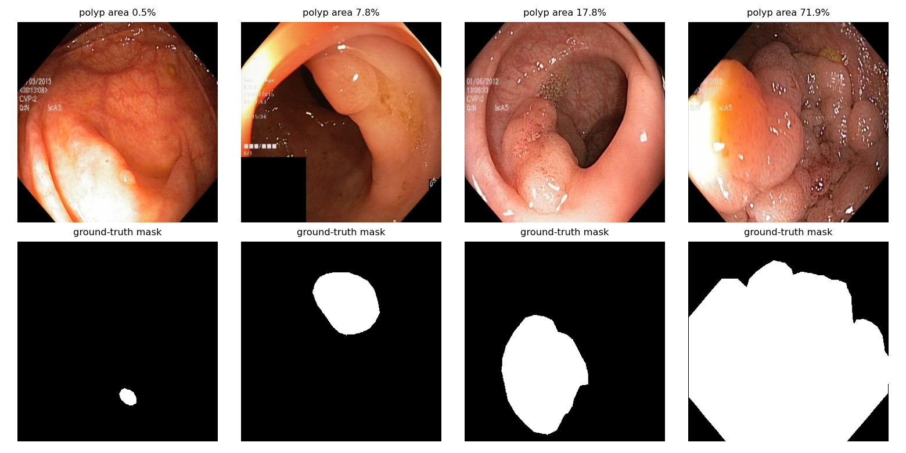
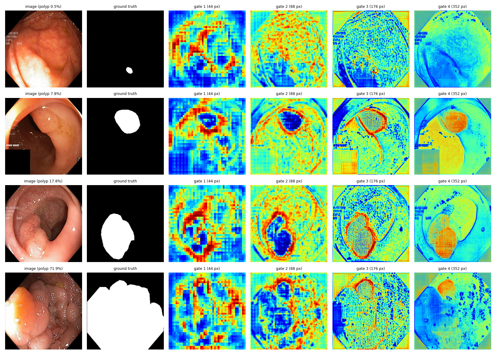
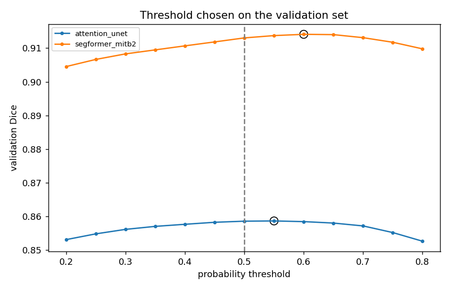
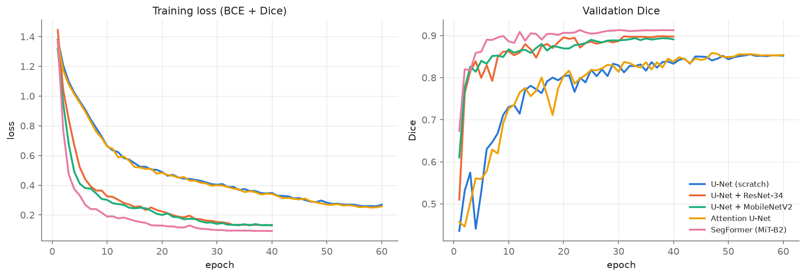
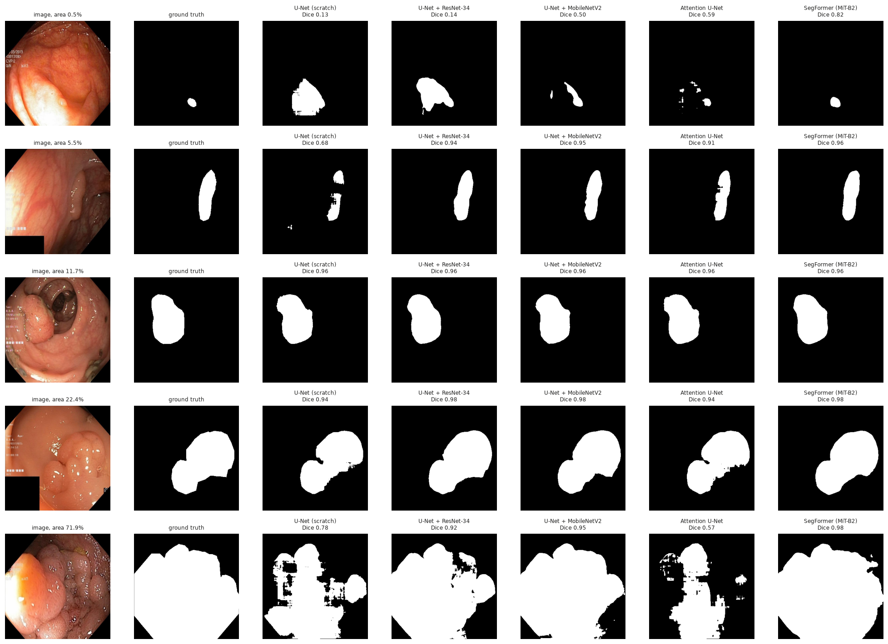
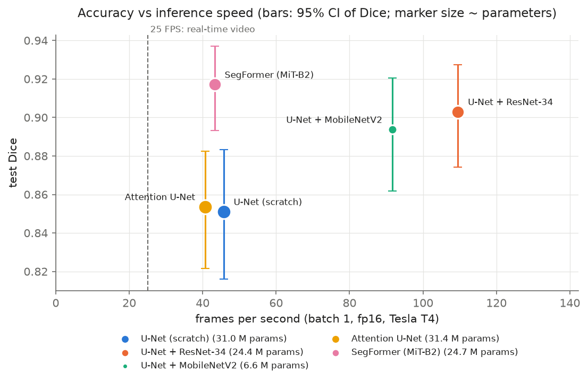
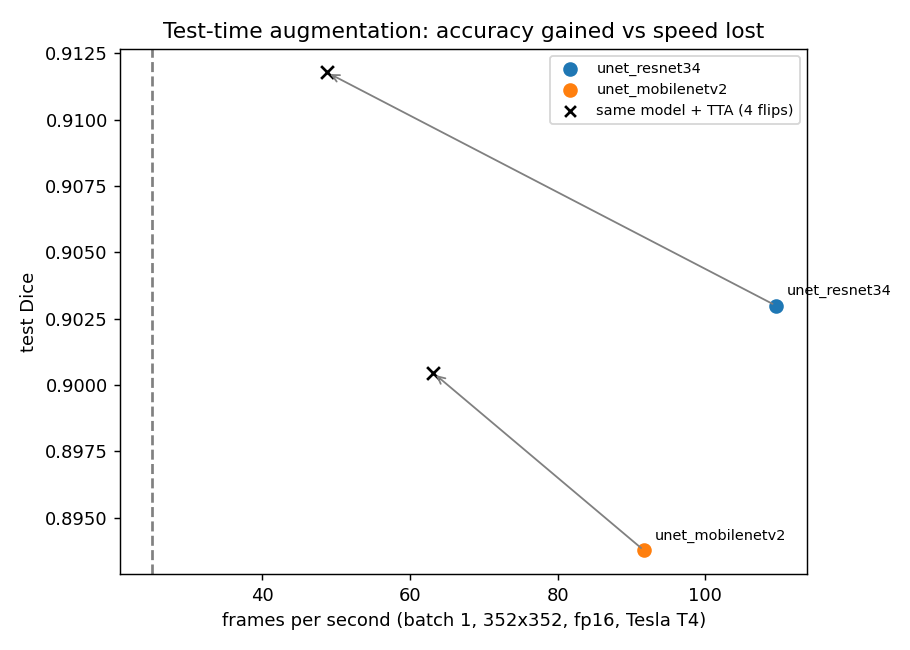
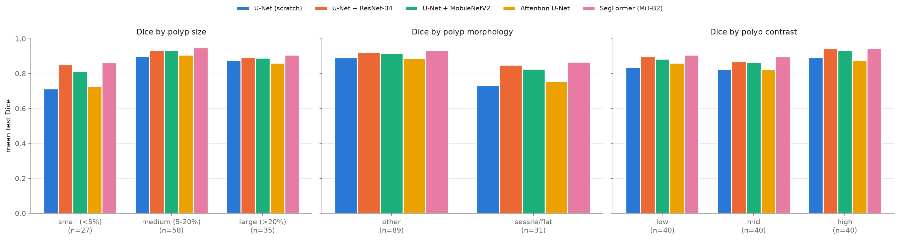
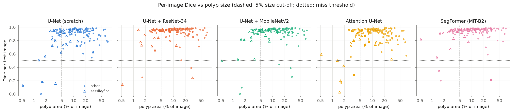
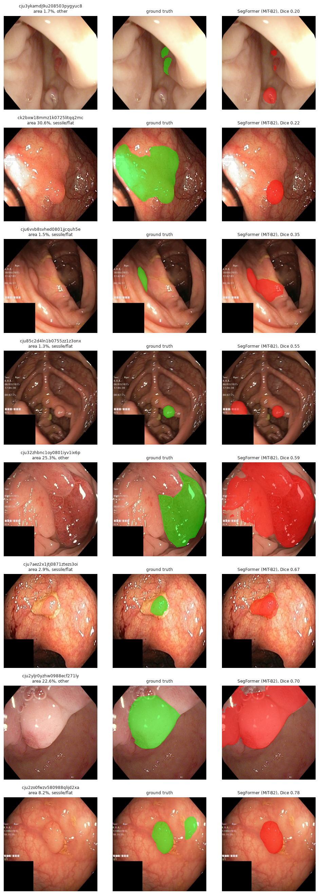

<!-- Assembled from report/sections/*.md; edit the sections, not this file. -->

# PolypHunter: Polyp Segmentation on Kvasir-SEG with U-Net and Its Variants

**P13 Deep Learning group project, Team 13**

Janu Chaudhary (leader), Challa Trivedh Kumar, Debangsu Misra, Manoj Kharkar

22 November 2026 · Code and results: https://github.com/Janu-Chaudhary/PolypHunter

## Abstract

Polyps missed during colonoscopy, most often small and flat ones, are linked to colorectal cancers that appear
between screenings. We compare five U-Net variants for polyp segmentation on Kvasir-SEG (1000 images, fixed
800/80/120 split): a U-Net trained from scratch, U-Nets with ImageNet-pretrained ResNet-34 and MobileNetV2
encoders, an Attention U-Net and SegFormer (MiT-B2). The baseline reaches a test Dice of 0.851. Attention gates
add nothing significant; pretrained encoders do: ResNet-34 reaches 0.903 and SegFormer 0.917, a difference that is
not significant under a paired bootstrap test. All five models exceed the 25 frames per second of live video on a
T4 GPU, ResNet-34 the most (110). Using expert sessile labels, we find that small and flat polyps remain the
hardest: the baseline misses 18.5% of small polyps, ResNet-34 and SegFormer 7.4%. On CVC-ClinicDB, from another
hospital, SegFormer loses only 0.05 Dice without retraining. We recommend SegFormer where accuracy matters most and
ResNet-34 where speed does.

## Contents

- [1. Introduction](#1-introduction)
- [2. Dataset](#2-dataset)
    - [2.1 Kvasir-SEG](#21-kvasir-seg)
    - [2.2 Split](#22-split)
    - [2.3 Preprocessing](#23-preprocessing)
    - [2.4 Data augmentation](#24-data-augmentation)
    - [2.5 Additional evaluation data](#25-additional-evaluation-data)
- [3. Method](#3-method)
    - [3.1 U-Net baseline and training setup](#31-u-net-baseline-and-training-setup)
    - [3.2 Pretrained encoders: ResNet-34 and MobileNetV2](#32-pretrained-encoders-resnet-34-and-mobilenetv2)
    - [3.3 Attention U-Net](#33-attention-u-net)
    - [3.4 SegFormer (MiT-B2 transformer encoder)](#34-segformer-mit-b2-transformer-encoder)
    - [3.5 Threshold tuning](#35-threshold-tuning)
- [4. Results](#4-results)
    - [4.1 Main results](#41-main-results)
    - [4.2 How certain are these numbers?](#42-how-certain-are-these-numbers)
    - [4.3 Training curves](#43-training-curves)
    - [4.4 Qualitative comparison](#44-qualitative-comparison)
    - [4.5 Summary](#45-summary)
- [5. Accuracy vs inference speed](#5-accuracy-vs-inference-speed)
- [6. Failure analysis: small and flat polyps](#6-failure-analysis-small-and-flat-polyps)
    - [6.1 How the groups are defined](#61-how-the-groups-are-defined)
    - [6.2 Results by group](#62-results-by-group)
    - [6.3 Worst cases](#63-worst-cases)
    - [6.4 What this means](#64-what-this-means)
- [7. Generalisation to CVC-ClinicDB](#7-generalisation-to-cvc-clinicdb)
- [8. Conclusion and limitations](#8-conclusion-and-limitations)
    - [8.1 Conclusion](#81-conclusion)
    - [8.2 Limitations](#82-limitations)
    - [8.3 Future work](#83-future-work)

## 1. Introduction

Colorectal cancer is one of the most common cancers worldwide and one of the leading causes of cancer
death (Sung et al., 2021). Most colorectal cancers grow out of **polyps**, small growths on the inner
wall of the colon that can turn malignant over several years. Finding and removing polyps during a
**colonoscopy**, a video examination of the colon, is therefore the main way to prevent the disease.

Colonoscopy is not perfect: a meta-analysis of tandem colonoscopy studies found that about a quarter of
adenomas are missed (Zhao et al., 2019), and every percentage point gained in a doctor's adenoma detection
rate is linked to a lower risk of cancer appearing before the next screening (Corley et al., 2014). The
polyps missed most often are the **small** ones and the **flat (sessile)** ones, which barely stand out
from the surrounding tissue.

Computer assistance can help here. **Semantic segmentation** labels every pixel of a colonoscopy frame as
polyp or background. Compared with only answering "is there a polyp?", a pixel mask shows the doctor the
polyp's exact location, size and outline, which supports both detection and the decision on how to remove it.
For this to be useful during a live examination, the model must also be fast enough to keep up with the
video stream, typically 25–30 frames per second.

In this project we study **U-Net** (Ronneberger et al., 2015), the standard architecture for biomedical
segmentation, and several of its variants on the public **Kvasir-SEG** dataset (Jha et al., 2020). Each
step changes one idea, so its effect can be measured:

1. a **U-Net trained from scratch**, the baseline;
2. a U-Net whose encoder is **pretrained on ImageNet** (ResNet-34), plus a lightweight **MobileNetV2**
   encoder, to measure the value of transfer learning;
3. an **Attention U-Net** (Oktay et al., 2018), which learns where to look, and **SegFormer**
   (Xie et al., 2021), which replaces the convolutional encoder with a transformer.

**Contributions.**
- A controlled comparison of five U-Net variants on the same fixed split, with the same augmentation,
  loss and evaluation code, reported with Dice and IoU.
- An **accuracy versus inference-speed** study on a single T4 GPU at batch size 1, which shows which models
  can run in real time during a colonoscopy, including the cost of test-time augmentation.
- A **failure analysis on small and flat polyps**, using polyp size, expert sessile/flat labels from
  Kvasir-Sessile (Jha et al., 2021) and a colour-contrast measure, together with miss rates.
- A **cross-dataset test** on CVC-ClinicDB (Bernal et al., 2015), images from another hospital, to show how
  well each model generalises without retraining.
- A public, reproducible code base in which each experiment runs as one notebook on a free GPU.

## 2. Dataset

### 2.1 Kvasir-SEG
Kvasir-SEG (Jha et al., 2020) contains **1000 colonoscopy images of polyps**, each with a pixel-level mask
in which white marks the polyp and black the background. The images were collected at Vestre Viken Health
Trust in Norway. The masks were drawn by a medical doctor and verified by an experienced gastroenterologist.
Image sizes vary from 332×487 to 1920×1072 pixels. Every image contains at least one polyp, and polyps differ
strongly in size, shape, colour and texture, which makes the dataset a realistic test of segmentation models.

Figure 2.1 shows four test images from the smallest to the largest polyp,
with their ground-truth masks. In our test set, the polyp covers between 0.5% and 71.9% of the image
(median 11.7%), and 27 of the 120 test images contain a small polyp (under 5% of the image).

<figure>

<figcaption><b>Figure 2.1.</b> Four test images, from the smallest to the largest polyp, with their ground-truth masks.</figcaption>
</figure>

### 2.2 Split
We split the 1000 images once with a fixed random seed (42) into **800 training, 80 validation and
120 test images**. The test-set size follows the Kvasir-SEG paper; the split itself is our own. All five
models use exactly the same split, which is stored in `results/split.json`.
- The **training set** is the only data the models learn from.
- The **validation set** is used for every choice made during development: keeping the best epoch
  and choosing the probability threshold.
- The **test set** is used only once per model, for the final numbers. It is never used to choose anything,
  so the reported scores are not optimistically biased.

### 2.3 Preprocessing
Every image is resized to **352×352 pixels**. Images use area interpolation, which keeps detail when
shrinking; masks use nearest-neighbour interpolation so they stay strictly binary. 352 is divisible by 16,
so the four 2×2 poolings of U-Net divide it exactly (352 → 176 → 88 → 44 → 22). Pixel values are scaled to
[0, 1] and normalised with the ImageNet mean and standard deviation. The pretrained encoders were trained on
this normalisation, and we use it for all models so that the input is identical everywhere. The masks are
stored as JPEG files, so we threshold them at 127 to remove compression noise.

### 2.4 Data augmentation
With only 800 training images, the models would quickly memorise the training set. During training we
therefore apply random augmentations, identically to the image and its mask, every time an image is loaded:

| Augmentation | Setting | Why |
|---|---|---|
| Horizontal and vertical flip | each with probability 0.5 | a colonoscope has no fixed "up" |
| Rotation by a multiple of 90° | uniform over 0°, 90°, 180°, 270° | same reason, and it is lossless |
| Rotation, scale and shift | probability 0.7: ±25°, scale 0.85–1.15, shift up to 6% | changing camera angle and distance |
| Brightness and contrast | probability 0.6: contrast ×0.8–1.2, brightness ±25 | changing light and exposure |

Validation and test images are never augmented.

### 2.5 Additional evaluation data
Two further datasets are used **only for evaluation**, never for training:
- **Kvasir-Sessile** (Jha et al., 2021): 196 of the Kvasir-SEG polyps that experts labelled as **sessile
  (flat) and smaller than 10 mm**. We use it to tag the flat polyps in our test set (31 of the 120 test
  images) for the failure analysis.
- **CVC-ClinicDB** (Bernal et al., 2015): 612 frames (384×288 pixels) from 29 colonoscopy videos recorded at
  Hospital Clínic in Barcelona, with expert masks. Because it comes from another hospital and another
  camera, it tests how well each model generalises beyond Kvasir-SEG.

## 3. Method

### 3.1 U-Net baseline and training setup

#### Architecture
Our baseline is the U-Net of Ronneberger et al. (2015), an encoder–decoder network shaped like the letter U.

- **Encoder (contracting path).** Five levels, each a *double convolution*: two 3×3 convolutions, each
  followed by batch normalisation and a ReLU. The number of channels doubles at every level:
  64 → 128 → 256 → 512 → 1024. Between levels, a 2×2 max-pooling halves the height and width, so a
  352×352 input becomes 176, 88, 44 and finally **22×22** pixels at the deepest level. Deeper levels see a
  larger part of the image and learn *what* is in it, but they lose *where* exactly it is.
- **Decoder (expanding path).** Four steps. Each step uses a 2×2 transposed convolution to double the
  resolution and halve the channels, then a double convolution, until the output is 352×352 again.
- **Skip connections.** Before each decoder double convolution, the decoder feature map is
  **concatenated with the encoder feature map of the same resolution**. This brings back the fine spatial
  detail (polyp edges) that pooling discarded, and is the key idea of U-Net.
- **Output.** A final 1×1 convolution maps the 64 channels to **one logit per pixel**. A sigmoid turns the
  logit into the probability that the pixel belongs to a polyp; pixels above a threshold (0.5 unless stated
  otherwise) form the predicted mask.

We make two common changes to the original design. First, we add **batch normalisation** after every
convolution, which makes training from scratch faster and more stable. Second, we use **padded convolutions**,
so the output has the same size as the input. The original U-Net used unpadded convolutions and had to crop
the skip connections. Our U-Net has **31.0 million parameters**.

#### Loss function
The loss is the sum of two terms:

L = BCE(p, g) + (1 − Dice(p, g))

where *p* are the predicted probabilities and *g* is the ground-truth mask.
- **Binary cross-entropy (BCE)** scores every pixel independently and gives smooth, stable gradients.
- **Soft Dice loss** scores the overlap between the whole predicted polyp and the true polyp. Polyps often
  cover less than 20% of the image, so a model trained with BCE alone can reach a low loss by predicting
  "background" almost everywhere. The Dice term prevents this, because it is computed only from the polyp
  pixels.

#### Optimisation
- **AdamW** (learning rate 3·10⁻⁴, weight decay 10⁻⁴), batch size 8.
- **OneCycle learning-rate schedule:** the learning rate rises during the first 10% of the steps (warm-up),
  then decays following a cosine curve, which gives stable early training and a fine final convergence.
- **60 epochs** of 100 steps each (800 images / batch 8).
- **Mixed precision (fp16)** on the GPU, which roughly halves memory use and speeds up training.
  The loss itself is computed in fp32 for numerical stability.
- **Model selection:** after every epoch we compute the Dice score on the validation set and keep the weights
  of the best epoch. The test set plays no part in this choice.
- A fixed random seed (42) controls the weight initialisation and the augmentation, so a rerun gives
  nearly the same model (some GPU operations are not bit-exact between runs).

Training the baseline took 46 minutes on an NVIDIA T4 GPU (60 epochs). The best validation Dice, 0.855,
was reached at epoch 54; by the last epoch it was still 0.852, so the model had converged without
overfitting the validation set.

#### Evaluation metrics
For each test image we compare the predicted mask *P* with the ground truth *G* and count true positives
(TP), false positives (FP) and false negatives (FN) pixels:

- **Dice** = 2·TP / (2·TP + FP + FN) = 2|P∩G| / (|P| + |G|)
- **IoU** (Jaccard index) = TP / (TP + FP + FN) = |P∩G| / |P∪G|
- **Precision** = TP / (TP + FP): how much of the prediction is really polyp.
- **Recall** = TP / (TP + FN): how much of the polyp was found.

Each metric is computed **per image and then averaged** over the 120 test images, so a small polyp counts as
much as a large one. Dice is always at least as large as IoU for the same prediction (Dice = 2·IoU / (1 + IoU)).

**Baseline result.** On the test set, the U-Net trained from scratch reaches a **Dice of 0.851** and an
**IoU of 0.774** (precision 0.867, recall 0.897). This is the reference point for every other model in Section 4.

### 3.2 Pretrained encoders: ResNet-34 and MobileNetV2

#### Why pretrain the encoder
Kvasir-SEG has only 800 training images, far too few to teach a U-Net encoder to recognise edges,
textures and shapes from scratch (Section 3.1's `unet_scratch` has to learn all of that from polyp images
alone). Transfer learning swaps the encoder for one already trained on ImageNet's 1.2 million natural
images: it starts out already knowing general-purpose visual features, and only has to adapt them to
colonoscopy images and learn the decoder from zero. This is the standard fix for small medical-imaging
datasets, where collecting and labelling more data is expensive. Both encoders below come from
`segmentation_models_pytorch`, which attaches a U-Net decoder (same skip-connection design as Section 3.1)
to a pretrained backbone.

#### ResNet-34 encoder (`unet_resnet34`)
Built with `smp.Unet("resnet34", encoder_weights="imagenet")`. ResNet-34's residual blocks add the input
of a block back onto its output (`y = F(x) + x`) instead of only passing it through convolutions. This
shortcut lets gradients flow directly through the skip path during backpropagation, which is what makes
very deep encoders like this one trainable at all, and is also why its ImageNet features transfer well: the
network can reuse early, general-purpose filters almost unchanged while later layers specialise. At
**24.4 M parameters** it is smaller than the from-scratch baseline (31.0 M, Section 3.1) even though it is
deeper, because its widest layers have 512 channels instead of 1024 (the baseline's 1024-channel bottleneck,
in the `UNet` class in `common.py`, alone holds about 14 M parameters), and the `smp` decoder (256 → 16
channels) is lighter than ours (512 → 64).

#### MobileNetV2 encoder (`unet_mobilenetv2`)
Built with `smp.Unet("mobilenet_v2", encoder_weights="imagenet")`. MobileNetV2 replaces each standard 3×3
convolution with a **depthwise-separable** block: a 3×3 convolution applied one channel at a time
(depthwise), followed by a 1×1 convolution that mixes channels (pointwise). A standard 3×3 convolution over
`C` channels costs `9·C²` multiply-adds per pixel; the depthwise-separable version costs `9·C + C²`, roughly
**8-9× fewer operations** for the channel counts used here. This is the encoder that trades some accuracy for
speed, at only **6.6 M parameters** — about a quarter of ResNet-34's size and a fifth of the baseline's. It
is our candidate for a model light enough to run in real time (Section 5).

#### Training setup
Both models train for **40 epochs**, fewer than the baseline's 60, because a pretrained encoder already
starts close to a good solution and converges faster — most of the remaining learning is in the decoder and
in adapting the encoder to this domain, not in re-learning low-level features. Only ResNet-34 uses a
learning rate lower than the baseline's: **2·10⁻⁴**, which keeps the early optimisation steps from making
large updates to the pretrained weights before the new decoder has learned anything useful — large early
updates would otherwise erase the ImageNet features before they can help. MobileNetV2 trains stably at the
baseline's own **3·10⁻⁴**, so it keeps that rate unchanged. Loss, optimiser (AdamW), schedule (OneCycle),
batch size and evaluation metrics are unchanged from Section 3.1.

On the test set, `unet_resnet34` reaches a **Dice of 0.903** (IoU 0.846) and `unet_mobilenetv2` reaches a
**Dice of 0.894** (IoU 0.835) — both well above the from-scratch baseline's 0.851, confirming that ImageNet
pretraining helps substantially on this small dataset even though the source images (natural photos) look
nothing like colonoscopy frames. The full comparison across all five models is in Section 4.

### 3.3 Attention U-Net

#### Idea
A plain U-Net copies every encoder feature into the decoder through its skip connections, including
features from folds, glare, instruments and on-screen text. The Attention U-Net of Oktay et al. (2018)
adds an **attention gate** to each skip connection, which learns **where to look**: it gives every pixel
of the skip feature a weight between 0 and 1, so background is suppressed before the decoder uses it.

#### Attention gate
For one skip connection, let
- **x** be the encoder skip feature map. It has fine resolution and knows *where* the edges are.
- **g** be the decoder feature map at the same resolution, just after upsampling. It comes from deeper in
  the network and carries the context of *what* a polyp looks like.

The gate computes one attention coefficient per pixel:

α = σ( ψ( ReLU( W_g·g + W_x·x ) ) ),    output = x · α

- **W_g** and **W_x** are 1×1 convolutions (each followed by batch normalisation) that project g and x
  into a shared space with half as many channels as x.
- Adding the two projections and applying ReLU keeps a location only where both the context (g) and the
  local detail (x) respond.
- **ψ** is a 1×1 convolution down to **one channel**, and **σ** is the sigmoid, so α ∈ [0, 1] at every pixel.
- The gated skip **x · α** replaces x in the concatenation. Pixels with α ≈ 0 contribute almost nothing.

#### Where the gates sit
The network is **identical to the baseline U-Net** of Section 3.1 (64 → 1024 channels, trained from scratch,
BCE + Dice loss, AdamW, learning rate 3·10⁻⁴, 60 epochs, OneCycle schedule, seed 42). The only change is
one gate on each of the four skip connections, at **44×44, 88×88, 176×176 and 352×352 pixels** (gates 1 to 4,
from the deepest to the shallowest). The gates add only 0.35 M parameters (31.4 M in total, +1.1%), so any
difference from the baseline comes from the gates themselves.

Training took 54 minutes on an NVIDIA T4. The best validation Dice, 0.859, was reached at epoch 47.

#### Result
On the test set the Attention U-Net reaches a **Dice of 0.854** and an **IoU of 0.775**
(precision 0.868, recall 0.895), against 0.851 / 0.774 for the baseline. The gain of **+0.003 Dice is
too small to be meaningful** from a single training run. With test-time augmentation it scores 0.857 (baseline 0.863), and on the unseen
CVC-ClinicDB data 0.741 (baseline 0.750). **On Kvasir-SEG, attention gates do not measurably improve a U-Net
trained from scratch.** A likely reason is that the baseline already learns to ignore most background through
its decoder, and 800 training images are not enough for the extra gating to pay off.

#### Attention maps
Figure 3.1 shows α for each gate on four test images, ordered from the smallest
polyp (0.5% of the image) to the largest (71.9%). Red means α close to 1 and blue means α close to 0.

<figure>

<figcaption><b>Figure 3.1.</b> Attention coefficients α of the four gates of the Attention U-Net on four test images (red: α close to 1, blue: α close to 0).</figcaption>
</figure>
- **Gate 1 (44 px)** is coarse and noisy. At this depth α marks broad regions rather than the polyp.
- **Gates 2 and 3 (88 and 176 px)** trace the **polyp boundary**: for the 7.8% and 17.8% polyps they draw a
  clear ring around the lesion. They mostly pass edge information, which is what the skip connections are
  for.
- **Gate 4 (352 px)** highlights the **polyp body** of the medium polyps and keeps much of the background low.
- **Where the gates help and where they hurt.** The per-image test Dice of these images shows both sides:
  - For the **tiny 0.5% polyp**, the maps are diffuse, but gate 3 shows a small ring at the lesion. The
    Attention U-Net reaches a Dice of **0.593 against 0.129** for the baseline, its clearest gain.
  - For the **71.9% polyp**, the gates highlight only part of it, because a lesion that fills the frame looks
    like background tissue. Dice falls to **0.573 against 0.781** for the baseline.
  - The gates also respond to **on-screen text and the black overlay box** in the corner. These artefacts are
    common in Kvasir-SEG, and α does not learn to ignore them.

These opposite effects on small and very large polyps largely cancel out, which explains why the average
Dice barely changes.

### 3.4 SegFormer (MiT-B2 transformer encoder)

#### Encoder: hierarchical transformer
SegFormer (Xie et al., 2021) replaces the convolutional encoder with a **Mix Transformer (MiT-B2)**.
- The image is cut into **overlapping patches** (a strided convolution), so neighbouring patches share pixels.
  Positional information comes from **Mix-FFN**, a 3×3 depthwise convolution inside each feed-forward layer,
  so no positional embedding is needed and the model works at any input size.
- Each transformer block applies **self-attention**: every patch compares itself with every other patch and
  takes a weighted average of them. Every location can therefore use the **whole image as context**, while a
  CNN only sees a local window that grows slowly with depth. To keep this affordable at high resolution,
  MiT uses *efficient* self-attention, which shrinks the keys and values by a fixed ratio.
- Four stages produce features at **1/4, 1/8, 1/16 and 1/32** of the input size (88, 44, 22 and 11 pixels for
  a 352×352 image), a multi-scale pyramid like a CNN's.

#### Decoder: all-MLP
The decoder is deliberately light. Each of the four feature maps is projected to the same number of channels
by an MLP (a 1×1 convolution), upsampled to 1/4 resolution, concatenated, fused by one more MLP, and mapped to
one logit per pixel. The prediction is made at **88×88**, and the segmentation head **bilinearly upsamples** it
×4 to 352×352 before the loss and metrics. (Our `Resize` wrapper would resize any other output to the input
size, but here it is only a safety net and never changes the output.)

#### Training setup
- Encoder initialised with **ImageNet-pretrained** MiT-B2 weights (`segmentation-models-pytorch` 0.6.0).
- The same loss, augmentation, split, batch size, optimiser and schedule as the U-Nets, except
  **40 epochs** and a **learning rate of 10⁻⁴**. Transformers are sensitive to large learning rates, which
  would destroy the pretrained weights.
- 24.7 M parameters. Training took only 12 minutes on an NVIDIA T4. The best validation Dice, 0.913, was
  reached at epoch 23.

#### Result
SegFormer is the strongest model so far:
- **Dice 0.917** and **IoU 0.865** on the test set (precision 0.911, recall 0.943), **+0.066 Dice** over the
  baseline, with fewer parameters.
- 0.926 with test-time augmentation.
- **0.863 on CVC-ClinicDB**, against 0.750 for the baseline. The gap is largest on the unseen dataset, which
  suggests that global context and ImageNet pretraining help the model generalise to a new hospital.

### 3.5 Threshold tuning

The models output a probability per pixel, and by default a pixel is called "polyp" when p > 0.5.
That value is a convention, not necessarily the best choice. We tune it as follows:

1. On the **validation set only**, compute the mean Dice for the thresholds 0.20, 0.25, …, 0.80.
2. Keep the threshold with the highest validation Dice (`thr_val`).
3. Apply it **once** to the test set (`dice_tuned`).

Choosing the threshold on the test set would leak test information into the model and over-state the score.
The test set must stay unseen until the final evaluation.

<figure>

<figcaption><b>Figure 3.2.</b> Validation Dice against the probability threshold.</figcaption>
</figure>
| Model | Best threshold (val) | Test Dice at 0.5 | Test Dice tuned | Gain |
|---|---|---|---|---|
| U-Net baseline | 0.50 | 0.851 | 0.851 | 0.000 |
| Attention U-Net | 0.55 | 0.854 | 0.854 | +0.0007 |
| SegFormer MiT-B2 | 0.60 | 0.917 | 0.918 | +0.0008 |

Both curves in Figure 3.2 are **flat around 0.5**: between 0.4 and 0.7, validation Dice
varies by only 0.0015 for the Attention U-Net and 0.0034 for SegFormer. The chosen thresholds sit just above
0.5, so the models are slightly better when they mark a pixel as polyp only when they are a little more
confident. The gain is **about +0.001 Dice (+0.0007 and +0.0008)**, so threshold tuning is not a meaningful
source of improvement here.

The flat curves show instead that the models' predictions are **confident (sharp)**: most pixels are
predicted close to 0 or 1. On the test set, only **3.0%** (Attention U-Net) and **2.2%** (SegFormer) of
pixels have a probability between 0.2 and 0.8, so moving the threshold changes very few of them, and the
default of 0.5 is a safe choice. This is not the same as *calibration*, which would mean that pixels
predicted at, say, 0.8 are polyp 80% of the time. We did not measure calibration.

## 4. Results

### 4.1 Main results
Table 4.1 compares the five models on the same 120 test images. All numbers are means over images: each
image is scored on its own and then averaged, so a small polyp counts as much as a large one (Section 3.1).
"Dice @0.5" uses the default probability threshold of 0.5. "Dice tuned" uses the threshold that was best on
the **validation** set (Section 3.5). "Dice TTA" averages the predictions of four flipped views of each image
(test-time augmentation). The speed columns are explained in Section 5.

**Table 4.1.** Test results on Kvasir-SEG (n = 120). Best value per column in bold.

| Model | Params (M) | Dice @0.5 | IoU @0.5 | Precision | Recall | Miss rate | Threshold | Dice tuned | Dice TTA | FPS (fp16) |
|---|---|---|---|---|---|---|---|---|---|---|
| U-Net (scratch) | 31.0 | 0.851 | 0.774 | 0.867 | 0.897 | 4.2% | 0.50 | 0.851 | 0.863 | 45.7 |
| U-Net + ResNet-34 | 24.4 | 0.903 | 0.846 | 0.919 | 0.917 | 3.3% | 0.60 | 0.904 | 0.912 | **109.5** |
| U-Net + MobileNetV2 | **6.6** | 0.894 | 0.835 | **0.928** | 0.898 | 5.0% | 0.45 | 0.894 | 0.900 | 91.7 |
| Attention U-Net | 31.4 | 0.854 | 0.775 | 0.868 | 0.895 | 5.0% | 0.55 | 0.854 | 0.857 | 40.7 |
| SegFormer (MiT-B2) | 24.7 | **0.917** | **0.865** | 0.911 | **0.943** | **2.5%** | 0.60 | **0.918** | **0.926** | 43.3 |

"Miss rate" is the share of test images with Dice below 0.5, where the polyp was essentially not found.
FPS is measured in fp16 for every model; SegFormer is the exception that runs faster in fp32 (56.9 frames per
second, Section 5).

What the table shows:
- **Baseline.** The U-Net trained from scratch already reaches a Dice of 0.851 and an IoU of 0.774. Its recall
  (0.897) is higher than its precision (0.867): it tends to over-segment a little, marking some healthy tissue
  around the polyp, rather than missing parts of the polyp.
- **Pretrained encoders.** Replacing the encoder with an ImageNet-pretrained CNN is the largest single
  improvement among the U-Nets: ResNet-34 reaches a Dice of 0.903 (+0.052 over the baseline) and MobileNetV2
  0.894 (+0.043), with fewer parameters (24.4 M and 6.6 M against 31.0 M). With only 800 training images,
  features learned on ImageNet transfer well even though natural photographs look nothing like colonoscopy
  frames. ResNet-34 alone closes about four fifths of the gap between the baseline and SegFormer. The two
  encoders err in different directions: ResNet-34 is balanced (precision 0.919, recall 0.917), while MobileNetV2
  has the highest precision of all models (0.928) but a recall no better than the baseline's (0.898), so it
  tends to under-segment, leaving out parts of the polyp.
- **Attention gates.** The Attention U-Net differs from the baseline only by its four attention gates, and it
  scores almost the same: Dice 0.854 against 0.851, IoU 0.775 against 0.774. It misses 6 polyps instead of 5,
  and the gates (0.4 M extra parameters, plus their extra computation at every skip connection) make it
  slightly slower (40.7 against 45.7 frames per second).
- **Transformer encoder.** SegFormer is the most accurate model: Dice 0.917 and IoU 0.865, 0.066 Dice above the
  baseline, with 6 M fewer parameters. It has the highest recall (0.943) with a precision close to the best, so
  it finds more of each polyp without marking much extra tissue. It misses only 3 of the 120 polyps.
- **Threshold tuning.** The best validation thresholds ranged from 0.45 to 0.60, and tuning changed test Dice
  by at most 0.001 for every model (Section 3.5). The predictions are sharp, with most pixels close to 0 or 1, so
  moving the threshold changes very few of them, and tuning is not a useful source of gain.
- **Test-time augmentation** raised the Dice of every model, by between 0.003 (Attention U-Net) and 0.012
  (baseline): ResNet-34 0.903 → 0.912, MobileNetV2 0.894 → 0.900, SegFormer 0.917 → 0.926. Section 5 discusses
  what it costs in speed.

### 4.2 How certain are these numbers?
120 test images are a sample: on another 120 polyps every mean would come out a little different. We estimate
how much with the **bootstrap** (Efron and Tibshirani, 1993): we draw 120 images from the test set *with
replacement*, recompute the mean Dice, repeat this 2000 times and report the middle 95% of these means as the
**95% confidence interval** (CI).

To decide whether one model really beats another, we bootstrap the **per-image difference** in Dice between
the two models. Because both models are scored on the same images, an unusually easy or hard image affects both
equally, so this paired comparison is much more sensitive than comparing two separate intervals. A gain counts
as significant when its 95% interval does not contain zero (two-sided p < 0.05).

**Table 4.2.** Mean test Dice with 95% bootstrap CI, and the gain over the U-Net baseline (paired bootstrap).

| Model | Dice [95% CI] | Gain over baseline [95% CI] | p |
|---|---|---|---|
| U-Net (scratch) | 0.851 [0.816, 0.883] | (baseline) | |
| U-Net + ResNet-34 | 0.903 [0.874, 0.928] | +0.052 [+0.028, +0.077] | < 0.001 |
| U-Net + MobileNetV2 | 0.894 [0.862, 0.921] | +0.043 [+0.023, +0.065] | < 0.001 |
| Attention U-Net | 0.854 [0.822, 0.882] | +0.003 [−0.011, +0.018] | 0.73 |
| SegFormer (MiT-B2) | 0.917 [0.893, 0.937] | +0.066 [+0.042, +0.093] | < 0.001 |

The baseline's interval is about ±0.034 wide, so with 120 test images a single mean Dice is only known to within
about three hundredths. Even so, the paired comparison separates the models clearly:
- **Both pretrained CNNs and SegFormer beat the baseline significantly.** Their gain intervals lie entirely above
  zero; in none of the 2000 resamples was any of the three worse than the baseline.
- **The attention gates' gain is not significant.** The interval for the Attention U-Net's gain, −0.011 to
  +0.018, contains zero (p = 0.73): on this test set, the gates make no measurable difference.

Because three models are far above the baseline, the more useful question is whether they differ from each
other. Table 4.3 applies the same paired test to the three best models.

**Table 4.3.** Paired comparison between the three most accurate models.

| Comparison | Dice gain [95% CI] | p |
|---|---|---|
| SegFormer − ResNet-34 | +0.014 [−0.006, +0.036] | 0.17 |
| SegFormer − MobileNetV2 | +0.023 [+0.008, +0.040] | 0.005 |
| ResNet-34 − MobileNetV2 | +0.009 [−0.009, +0.027] | 0.33 |

SegFormer is significantly more accurate than MobileNetV2, but **not significantly more accurate than
ResNet-34**, and ResNet-34 is not significantly more accurate than MobileNetV2. "Not significant" does not mean
"the same": these intervals are about ±0.02 wide, so with 120 test images a real difference of 0.014 could
neither be confirmed nor ruled out. All pairs are in `results/summary/pairwise_dice.csv`. These intervals
cover the choice of test images only, not the randomness of training (Section 8.2).

### 4.3 Training curves
Figure 4.1 shows the training loss and the validation Dice of every model per
epoch. The two models trained from scratch learn slowly: the baseline reached its best validation Dice (0.855)
at epoch 54 of 60, the Attention U-Net (0.859) at epoch 47, and both needed about 39 epochs to come within 2% of
their best. The three models with a pretrained encoder start much higher and converge in fewer epochs:
MobileNetV2 came within 2% of its best after 16 epochs, ResNet-34 after 19 and SegFormer after only 8.
They peaked at validation Dice 0.894 (epoch 33 of 40), 0.899 (epoch 38) and 0.913 (epoch 23). Pretrained models
also trained much faster: 8 minutes for MobileNetV2, 9 for ResNet-34 and 12 for SegFormer, against 46 for the
baseline and 54 for the Attention U-Net. No model overfitted: the validation Dice at the last epoch was within
0.005 of each model's best.

<figure>

<figcaption><b>Figure 4.1.</b> Training loss (left) and validation Dice (right) per epoch for all five models.</figcaption>
</figure>

### 4.4 Qualitative comparison
Figure 4.2 shows five test polyps, from the smallest to the largest, with the
ground truth and the mask predicted by each model.
- **The smallest polyp (0.5% of the image)** separates the models most. The scratch U-Net and ResNet-34 both mark
  a large bright region nearby instead of the polyp (Dice 0.13 and 0.14). MobileNetV2 and the Attention U-Net find
  it only partly, among scattered false detections (0.50 and 0.59). Only SegFormer outlines it cleanly (0.82).
- **A thin, elongated polyp (5.5%)**: the scratch U-Net breaks the mask into fragments (0.68), while the other four
  models score 0.91–0.96.
- **A medium polyp (11.7%)** is easy for every model (all 0.96).
- **Large polyps (22.4% and 71.9%)**: the difference is in the quality of the mask. The two scratch models
  produce ragged, blocky borders, and on the largest polyp, which fills most of the frame, they leave holes and
  fragments (scratch U-Net 0.78, Attention U-Net 0.57). The three pretrained models produce smooth, filled masks
  (0.92–0.98).

<figure>

<figcaption><b>Figure 4.2.</b> Five test polyps, from the smallest to the largest: image, ground truth and the mask predicted by each model, with its Dice.</figcaption>
</figure>

Pretrained encoders therefore help at both ends of the size range: they find small polyps more often and give
cleaner, complete masks on large ones.

### 4.5 Summary
The five models fall into three accuracy tiers. The two U-Nets trained from scratch score about 0.85, and
attention gates add nothing measurable. The U-Nets with ImageNet-pretrained CNN encoders reach 0.89–0.90, a
significant gain from transfer learning alone. SegFormer, with a pretrained transformer encoder, is the most
accurate at 0.917, although its lead over ResNet-34 is not statistically significant on 120 test images. All
five models run above 25 frames per second in fp16. Figure 4.3 puts accuracy
and speed together: U-Net + ResNet-34 gives the best accuracy for its speed, as the fastest model (109.5 frames
per second) and within the error margin of SegFormer. Section 6 shows where the remaining errors are.

<figure>

<figcaption><b>Figure 4.3.</b> Test Dice against inference speed (batch 1, fp16, T4 GPU). Vertical bars: 95% bootstrap confidence interval of the Dice; marker size grows with the number of parameters; dashed line: 25 frames per second.</figcaption>
</figure>

## 5. Accuracy vs inference speed

A segmentation model is only useful at the bedside if it can keep up with live colonoscopy video, which
arrives at **25-30 frames per second**. This section measures whether our five models can, and what it
costs to make them more accurate.

#### Measurement protocol (`fps()` in `common.py`)
- **Batch size 1.** Live video arrives one frame at a time, not as a batch, so batching would overstate
  real-world throughput.
- **Input 352×352**, the same resolution every model trains and evaluates at, run on a Kaggle **T4** GPU.
- **20 warm-up calls, not timed.** The first calls to a GPU model are slow: CUDA allocates memory and cuDNN
  benchmarks several convolution algorithms before picking the fastest one. Timing these would measure
  one-off setup cost, not steady-state speed.
- **200 timed calls**, with `torch.cuda.synchronize()` immediately before and after the timed block. GPU
  calls are asynchronous — the Python call returns as soon as the work is *queued*, not when it finishes —
  so without synchronising, the measured time would be wrong (usually far too short).
- Reported as **`fps_fp32`**, **`fps_fp16`** (mixed precision) and **`fps_fp16_tta`** (fp16 with test-time
  augmentation, see below). Mixed precision is not a uniform win: see "Does fp16 always help?" below — the
  gain depends on the architecture, and for one model (SegFormer) fp16 is actually slower.
- **ms per frame = 1000 / FPS** — the number that actually determines whether a frame is processed before
  the next one arrives.

#### Test-time augmentation (TTA)
For each frame we predict on the original image and on its horizontal flip, vertical flip, and both flips
combined, flip each prediction back to the original orientation, and average the four. Averaging smooths
out orientation-dependent errors, so it usually improves Dice a little (`dice_tta`). `fps()` times this as
**one batch of 4** (the four flipped views go through the model together), not as four separate forward
passes, so the throughput cost is not a fixed ~4× — it depends on how well each architecture's layers batch,
and ranges from 1.3× to 3.2× across our five models (see below). Figure 5.1 plots this
trade-off for our two pretrained models: an arrow from the no-TTA point to the TTA point of the same model,
right-to-left meaning slower and upward meaning more accurate. (The figure only covers the two models
trained in this notebook; extending it to all five is an analysis-stage follow-up, not part of this section.)

<figure>

<figcaption><b>Figure 5.1.</b> Test-time augmentation for the two pretrained CNN U-Nets: each arrow goes from the model without TTA to the same model with TTA.</figcaption>
</figure>

#### Results across all five models

| Model | Params (M) | FPS fp32 | FPS fp16 | FPS fp16+TTA | ms/frame (fp16) | Dice | Dice+TTA |
|---|---|---|---|---|---|---|---|
| U-Net (scratch) | 31.0 | 11.6 | 45.7 | 14.7 | 21.9 | 0.851 | 0.863 |
| U-Net + ResNet-34 | 24.4 | 44.9 | 109.5 | 48.7 | 9.1 | 0.903 | 0.912 |
| U-Net + MobileNetV2 | 6.6 | 86.5 | 91.7 | 63.1 | 10.9 | 0.894 | 0.900 |
| Attention U-Net | 31.4 | 10.6 | 40.7 | 12.7 | 24.6 | 0.854 | 0.857 |
| SegFormer (MiT-B2) | 24.7 | 56.9 | 43.3 | 32.8 | 23.1 | 0.917 | 0.926 |

#### Which models reach 25 FPS
**In fp16**, all five models clear 25 FPS without TTA, from the slowest (Attention U-Net, 40.7 FPS) to the
fastest (ResNet-34, 109.5 FPS) — at this resolution, fp16 throughput is not the bottleneck for any of them.
**In fp32**, the picture is different: the scratch U-Net (11.6 FPS) and Attention U-Net (10.6 FPS) fall well
short of 25 FPS, because they apply full 3×3 convolutions at full resolution and through a 1024-channel
bottleneck — far more computation per frame than the pretrained encoders, which downsample early. In fp16
the T4's tensor cores absorb most of that cost; only ResNet-34 (44.9), MobileNetV2 (86.5) and SegFormer
(56.9) clear 25 FPS in fp32 itself.

With TTA (always timed in fp16), the scratch baseline and Attention U-Net both drop below the real-time
threshold (14.7 and 12.7 FPS), while ResNet-34 (48.7), MobileNetV2 (63.1) and SegFormer (32.8) stay above
it. MobileNetV2 does **not** keep the largest margin in every configuration: in fp16 without TTA, ResNet-34
is faster (109.5 vs 91.7 FPS) — MobileNetV2 leads only in fp32 (86.5) and in fp16+TTA (63.1), where its
depthwise-separable blocks batch the four TTA views more cheaply. This matters in practice because a
deployed system also spends time on video decoding, pre/post-processing and display, not just the model's
forward pass — the raw FPS number is a ceiling, not what the clinician actually gets.

#### Is TTA worth it?
TTA buys a small Dice gain for every model (+0.003 to +0.012) at a cost in frames per second that varies a
lot by architecture: 3.1× for the scratch baseline (45.7 → 14.7), 3.2× for Attention U-Net (40.7 → 12.7),
2.25× for ResNet-34 (109.5 → 48.7), 1.45× for MobileNetV2 (91.7 → 63.1) and 1.32× for SegFormer
(43.3 → 32.8). The two models whose fp16 speed already sits close to the 25 FPS floor (the scratch baseline
and Attention U-Net) are pushed below it by TTA; the other three stay above it, with MobileNetV2 keeping the
most headroom (63.1 FPS) and SegFormer the least (32.8 FPS, still about 31% above the floor).

#### Does fp16 always help?
No — the gain is model-dependent. Going from fp32 to fp16 speeds up the standard-convolution U-Nets a lot
(scratch 3.9×, Attention U-Net 3.8×, ResNet-34 2.4×), but MobileNetV2 gains only 1.06× (86.5 → 91.7): its
depthwise convolutions make little use of tensor cores, and at this size per-layer overhead dominates.
SegFormer is **slower** in fp16 than in fp32 (56.9 → 43.3): mixed precision adds type casts, and its
attention and normalisation layers gain little from it. The practical conclusion is that each model should
be deployed in whichever precision is actually faster for it — fp16 for the four U-Net variants, but fp32
for SegFormer.

#### Recommendation
Across all five models, two poles stand out. SegFormer (MiT-B2) is the most accurate model we trained —
Dice 0.917 [95% CI 0.893, 0.937], rising to 0.926 with TTA — and still clears the real-time floor with TTA
at 32.8 FPS (about 31% above 25 FPS), but it must be deployed in **fp32** (56.9 FPS without TTA) to reach
its best speed, not fp16. U-Net + MobileNetV2 trades some of that accuracy for raw speed headroom: Dice
0.894 [0.862, 0.921] (0.900 with TTA) but 63.1 FPS with TTA, at only 6.6 M parameters.

A paired bootstrap over the same 120 test images (2000 resamples, Section 4.2's method) shows SegFormer's
edge over MobileNetV2 is real (+0.023 Dice [0.008, 0.040], p = 0.005), and MobileNetV2 also has the highest
miss rate of the three fast models (5.0% vs SegFormer's 2.5%) and the largest accuracy drop of all five
models on the out-of-distribution CVC-ClinicDB set (0.141, more than the scratch baseline's 0.101) — a
generalisation concern beyond raw Dice.

U-Net + ResNet-34 sits between the two poles: Dice 0.903 [0.874, 0.928] (0.912 with TTA), not significantly
different from either SegFormer (+0.014 [-0.006, 0.036], p = 0.17) or MobileNetV2 (+0.009 [-0.009, 0.027],
p = 0.33) on our 120 test images — with n = 120 the test has little power, so "not significant" is not the
same claim as "the same". By speed: ResNet-34 reaches 109.5 FPS in fp16 without TTA, about 1.9× SegFormer's
best (56.9 FPS in fp32 without TTA), or 48.7 FPS in fp16 with TTA against SegFormer's 32.8 FPS in fp16 with
TTA (SegFormer with TTA was only measured in fp16, not fp32). ResNet-34 also generalises to CVC-ClinicDB far
better than MobileNetV2 (drop of 0.075 vs 0.141).

Our recommendation: **SegFormer, run in fp32 (56.9 FPS without TTA, 32.8 FPS in fp16 with TTA), where
accuracy is the priority**, and **U-Net + ResNet-34, run in fp16 (109.5 FPS without TTA, 48.7 FPS with
TTA), where real-time speed matters most** — its Dice is not significantly different from SegFormer's on
our 120 test images (p = 0.17) while it is markedly faster and more robust on CVC-ClinicDB than MobileNetV2.
We do not recommend MobileNetV2 for deployment despite its FPS headroom, given its weaker generalisation and
higher miss rate. (Section 8 carries the project-wide recommendation; it should match this comparison.)

## 6. Failure analysis: small and flat polyps

A mean Dice of 0.85 or 0.92 hides where a model fails. Clinically, the polyps that doctors miss most often are the
**small** and the **flat (sessile)** ones (Section 1). In this section we split the 120 test images into groups
and check whether the models fail on the same polyps that doctors do.

### 6.1 How the groups are defined
- **Size:** the polyp's share of the image, measured on the original-resolution mask.
  Small < 5%, medium 5–20%, large > 20%.
- **Morphology:** a test image is **sessile/flat** if it is listed in Kvasir-Sessile (Jha et al., 2021), a set of
  196 Kvasir-SEG polyps that experts labelled sessile and smaller than 10 mm. This is a real expert label.
- **Contrast:** the colour difference (ΔE in CIELAB colour space) between the polyp and a ring of tissue
  12 pixels wide around it, measured on the 352×352 image. The test set is split into thirds: low, mid and high contrast. A low value means the
  polyp blends into the colon wall. This is only a **stand-in** for "hard to see", computed by us, not an expert label.
- **Miss rate:** the share of images with Dice < 0.5, meaning the polyp was essentially not found. A missed polyp
  is clinically worse than a slightly wrong outline, so we report it next to the mean Dice.

Some groups are small (n = 27 small polyps, 31 sessile polyps), so a single image moves a group's mean noticeably.
We therefore give **n** for every group and treat differences of a few hundredths with caution.

### 6.2 Results by group
**Table 6.1.** Mean test Dice (miss rate) per group.

| Group | n | U-Net (scratch) | ResNet-34 | MobileNetV2 | Attention U-Net | SegFormer |
|---|---|---|---|---|---|---|
| Small (< 5%) | 27 | 0.713 (18.5%) | 0.851 (7.4%) | 0.812 (11.1%) | 0.730 (22.2%) | 0.862 (7.4%) |
| Medium (5–20%) | 58 | 0.900 (0.0%) | 0.934 (0.0%) | 0.934 (1.7%) | 0.906 (0.0%) | 0.948 (0.0%) |
| Large (> 20%) | 35 | 0.876 (0.0%) | 0.891 (5.7%) | 0.890 (5.7%) | 0.862 (0.0%) | 0.908 (2.9%) |
| Sessile/flat | 31 | 0.734 (12.9%) | 0.850 (6.5%) | 0.826 (9.7%) | 0.758 (16.1%) | 0.867 (6.5%) |
| Other | 89 | 0.892 (1.1%) | 0.922 (2.2%) | 0.917 (3.4%) | 0.887 (1.1%) | 0.934 (1.1%) |
| Low contrast | 40 | 0.836 (5.0%) | 0.896 (2.5%) | 0.883 (7.5%) | 0.861 (2.5%) | 0.907 (2.5%) |
| Mid contrast | 40 | 0.825 (7.5%) | 0.869 (7.5%) | 0.865 (7.5%) | 0.823 (10.0%) | 0.898 (5.0%) |
| High contrast | 40 | 0.892 (0.0%) | 0.943 (0.0%) | 0.933 (0.0%) | 0.876 (2.5%) | 0.946 (0.0%) |

Figure 6.1 shows the same means as bar charts, and Figure 6.2 plots the Dice of every test image against its polyp size.

<figure>

<figcaption><b>Figure 6.1.</b> Mean test Dice per group: polyp size, morphology (Kvasir-Sessile) and contrast.</figcaption>
</figure>

<figure>

<figcaption><b>Figure 6.2.</b> Dice of every test image against polyp size (log scale), one panel per model. Triangles: sessile polyps; dashed line: 5% size cut-off; dotted line: miss threshold (Dice 0.5).</figcaption>
</figure>

**Small polyps are the main weakness.** The baseline scores 0.713 on small polyps against 0.900 on medium ones,
and it misses 5 of the 27 small polyps (18.5%). It misses no medium or large polyp at all: all five complete
misses in the test set are small polyps. The Attention U-Net behaves the same way (0.730 on small polyps, 6 of
27 missed, again all of its misses are small polyps), so the attention gates do not help where help is needed
most. **Pretrained encoders narrow the gap most.** ResNet-34 raises the Dice on small polyps by 0.138
(0.713 → 0.851) and SegFormer by 0.149 (→ 0.862), far more than their gains on medium polyps (+0.034 and
+0.048). Both miss only 2 of the 27 small polyps (7.4%); MobileNetV2 is in between (0.812, 3 missed). The
improvement from a pretrained encoder is therefore largest exactly on the hard cases, not only on polyps that
were already easy.

**Flat polyps are almost as hard.** For the baseline, sessile polyps score 0.734 against 0.892 for the others,
with a miss rate of 12.9% against 1.1%. The Attention U-Net is similar (0.758, 16.1% missed). ResNet-34 and
SegFormer halve the miss rate on sessile polyps, to 6.5% (2 of 31), with Dice 0.850 and 0.867; MobileNetV2
lowers it less, to 9.7% (Dice 0.826). A gap to the other polyps remains for every model
(SegFormer 0.867 against 0.934).

**Small and flat overlap.** The two groups are largely the same polyps: 18 of the 27 small polyps are sessile,
because Kvasir-Sessile only contains polyps under 10 mm. Table 6.2 separates the two factors.

**Table 6.2.** Mean test Dice (miss rate) by size and morphology together.

| Group | n | U-Net (scratch) | ResNet-34 | MobileNetV2 | Attention U-Net | SegFormer |
|---|---|---|---|---|---|---|
| Other, not small | 80 | 0.899 (0.0%) | 0.927 (1.2%) | 0.924 (2.5%) | 0.896 (0.0%) | 0.942 (0.0%) |
| Other, small | 9 | 0.826 (11.1%) | 0.874 (11.1%) | 0.858 (11.1%) | 0.804 (11.1%) | 0.870 (11.1%) |
| Sessile, not small | 13 | 0.840 (0.0%) | 0.863 (7.7%) | 0.878 (7.7%) | 0.848 (0.0%) | 0.880 (7.7%) |
| Sessile, small | 18 | 0.657 (22.2%) | 0.840 (5.6%) | 0.789 (11.1%) | 0.693 (27.8%) | 0.858 (5.6%) |

For the two CNNs trained from scratch, both factors lower the Dice on their own, and polyps that are both small
and flat are by far the hardest: the baseline misses 4 of these 18 polyps and the Attention U-Net 5. The
pretrained encoders shrink this weakness: MobileNetV2 misses 2 of the 18, and ResNet-34 and SegFormer only 1
each. For SegFormer (0.858) and ResNet-34 (0.840), the Dice on small sessile polyps is close to their Dice on the
other groups; MobileNetV2 still lags (0.789). With only 9 and 13 images in two of the cells, where one image
changes the miss rate by 8–11 points, this split is indicative only.

**Contrast matters less than size.** All five models score lower on low- and mid-contrast polyps than on
high-contrast ones: for the baseline about 0.83 against 0.89, for ResNet-34 0.896 and 0.869 against 0.943, and
for SegFormer 0.907 and 0.898 against 0.946. The effect is smaller than for size, and low and mid contrast are
not clearly different. Sessile polyps do have lower contrast (median ΔE 19.6 against 42.0), which fits the
clinical picture of flat lesions that blend into the wall.

**A new failure mode: large polyps.** The models trained from scratch miss no polyp larger than 5% of the image,
but the three pretrained models each miss one or two large ones. Two large polyps (28% and 31% of the image, the
second one sessile) are missed by both ResNet-34 and MobileNetV2, and the second one also by SegFormer, while
both scratch models find them. Pretraining therefore trades many misses on small polyps for a few misses on
large ones. Both images show the same pattern: the polyp has a raised, dome-shaped part and a large flat part
around it, and the pretrained models outline only the dome. On the sessile one (`ck2bxw…`, row 2 of Figure 6.3)
all three pretrained models mark only a small round nodule at the lower edge of a lesion that covers almost a
third of the image. The scratch U-Net covers more of the flat area, though with a patchy, low-confidence mask.
The pretrained encoders seem to have learned a strong idea of a polyp as a compact, raised blob, which helps them
find small polyps but makes them overlook wide, flat lesions.

### 6.3 Worst cases
Figure 6.3 shows the eight test images on which the best model, SegFormer, scored
lowest, with the ground truth in green and the prediction in red. Likely reasons:

<figure>

<figcaption><b>Figure 6.3.</b> The eight test images on which SegFormer scored lowest: ground truth in green, prediction in red.</figcaption>
</figure>

1. `cju3ykamdj…` (1.7% of the image, Dice 0.20): a tiny reddish polyp in a fold next to an over-exposed bright
   fold. SegFormer marks only a sliver of it and marks a round bump of normal tissue below it instead.
2. `ck2bxw18mm…` (30.6%, sessile, Dice 0.22): a large flat lesion that blends into the wall, with glare at the
   upper left. SegFormer finds only the raised nodule at its lower edge (see Section 6.2).
3. `cju6vvb8sv…` (1.5%, sessile, Dice 0.35): a small flat polyp on a fold. The prediction covers it but spreads
   along the fold onto neighbouring tissue, so most of the predicted area is wrong.
4. `cju85c2d4l…` (1.3%, sessile, Dice 0.55): the small polyp is found correctly, but a second round structure at
   the left edge of the image, next to the black overlay box, is also marked as a polyp.
5. `cju32zhbnc…` (25.3%, Dice 0.59): the polyp is found, but the prediction also covers the large neighbouring fold
   on its left, which has a similar colour and texture.
6. `cju7aez2x1…` (2.9%, sessile, Dice 0.67): the polyp sits inside a yellowish rim. The ground truth covers only
   the central part and the prediction includes the rim, where the true border is ambiguous.
7. `cju2yljr0y…` (22.6%, Dice 0.70): a pale, glossy polyp with strong glare. The prediction extends onto the fold
   above and to the left of it.
8. `cju2zo0fwz…` (8.2%, sessile, Dice 0.78): the image contains two polyps. SegFormer outlines the larger one
   well but misses the second.

Four of the eight are small polyps and five are sessile, so the groups of Section 6.2 are again
over-represented. Only three of the eight (images 1–3) are misses with Dice below 0.5. In the other five,
SegFormer finds the polyp but gets its extent wrong: four times it spreads onto a neighbouring fold or rim, and
once it misses a second polyp. Its remaining errors are therefore mostly about **where the polyp ends** rather than
**whether there is a polyp**, the opposite of the scratch models, whose failures are mostly missed small polyps.

### 6.4 What this means
SegFormer and U-Net + ResNet-34 are the most reliable models on the polyps that matter most clinically. Each
misses only 2 of the 27 small polyps and 1 of the 18 small sessile polyps, against 5 and 4 for the baseline, and
they miss 3 and 4 of the 120 test polyps overall, against 5 for the baseline. Their misses are not limited to
small polyps, as the scratch models' are: each misses at least one large polyp, so they fail less often but not
in a fully predictable way. Small and flat polyps remain the weakest groups for every model, so they still need
the doctor's full attention.

## 7. Generalisation to CVC-ClinicDB

A model that will be used in another hospital must work on images from other cameras, other lighting and other
patients. To test this, every model trained on Kvasir-SEG was also evaluated on **CVC-ClinicDB** (Bernal et al.,
2015) **without any retraining**: 612 frames from 29 colonoscopy videos recorded in Barcelona with a different
endoscope (Section 2.5). The images are resized and normalised exactly like the Kvasir-SEG images, and the
threshold is 0.5.

**Table 7.1.** Dice on the Kvasir-SEG test set and on CVC-ClinicDB, and the drop between them.

| Model | Kvasir-SEG Dice (n = 120) | CVC-ClinicDB Dice (n = 612) | CVC IoU | Drop |
|---|---|---|---|---|
| U-Net (scratch) | 0.851 | 0.750 | 0.655 | 0.101 |
| U-Net + ResNet-34 | 0.903 | 0.828 | 0.754 | 0.075 |
| U-Net + MobileNetV2 | 0.894 | 0.753 | 0.680 | 0.141 |
| Attention U-Net | 0.854 | 0.741 | 0.646 | 0.113 |
| SegFormer (MiT-B2) | 0.917 | 0.863 | 0.787 | 0.054 |

**Models trained from scratch.** The baseline loses 0.101 Dice on the new hospital's images (0.851 → 0.750). It
still finds most polyps, but a tenth of its overlap is lost, which shows that it has partly learned features
specific to Kvasir-SEG's camera and image style. The Attention U-Net loses slightly more (0.113) and ends up a
little below the baseline on CVC (0.741 against 0.750): the attention gates do not make the model more robust
to a new hospital either.

**SegFormer.** SegFormer loses only 0.054 Dice, about half as much as the two models trained from scratch, and
keeps a Dice of 0.863 on CVC-ClinicDB. Its lead over the baseline grows from 0.066 on Kvasir-SEG to 0.113 on
CVC-ClinicDB. Two of its properties may explain this: its encoder was pretrained on ImageNet, so it starts from
features learned on over a million varied photographs rather than on 800 colonoscopy images; and its
self-attention relates every part of the image to every other part, which may make it rely less on local colour
and texture that change between cameras.

**Pretrained CNN encoders.** ResNet-34 and MobileNetV2 were also pretrained on ImageNet but are CNNs, so they help
separate these two explanations. They do not behave alike. ResNet-34 loses 0.075 Dice and keeps 0.828 on
CVC-ClinicDB, between the scratch models and SegFormer. MobileNetV2 loses 0.141, **the largest drop of all five
models**: on Kvasir-SEG it was 0.043 above the baseline, on CVC-ClinicDB only 0.003. ImageNet pretraining alone
therefore does not guarantee robustness to a new hospital. It helped the larger ResNet-34 encoder (24.4 M
parameters), but not the compact MobileNetV2 (6.6 M), whose small capacity may be used up fitting Kvasir-SEG's
own image style. SegFormer, pretrained *and* attention-based, transfers best, which suggests that both pretraining
and the transformer encoder contribute, although one seed per model and one external dataset cannot prove this.

The ranking on CVC-ClinicDB is almost the same as on Kvasir-SEG: SegFormer, then ResNet-34, then the other three.
The one change is that MobileNetV2 falls back to the level of the scratch models (0.753 against 0.750 and 0.741).
For deployment in a hospital whose images were not seen in training, SegFormer and ResNet-34 are the safer
choices.

**Caveats.**
- CVC-ClinicDB frames come from only 29 videos, so neighbouring frames are very similar and the 612 frames are
  far from 612 independent cases.
- Its images are smaller (384×288) than most Kvasir-SEG images and wider than they are tall. Resizing them to
  352×352 stretches them vertically and changes their apparent sharpness, so polyps look slightly different
  from those the models were trained on.
- We use no CVC image for training or for choosing anything, so these numbers are a fair test of transfer, but a
  single seed means differences of about 0.01 (such as between the baseline, the Attention U-Net and MobileNetV2
  on CVC) should not be over-interpreted.

## 8. Conclusion and limitations

### 8.1 Conclusion
We compared five U-Net variants for polyp segmentation on Kvasir-SEG, all trained and evaluated with the same
split, augmentation, loss and code. The U-Net trained from scratch is already a strong baseline (Dice 0.851,
IoU 0.774). Adding attention gates changed nothing measurable (+0.003 Dice, p = 0.73). What mattered was a
pretrained encoder: ImageNet-pretrained CNN encoders raised the Dice significantly (ResNet-34 +0.052 to 0.903,
MobileNetV2 +0.043 to 0.894), and SegFormer's pretrained transformer encoder gave the largest gain (+0.066, to
0.917). SegFormer's lead over ResNet-34 (+0.014) is not statistically significant on 120 test images (p = 0.17).

**Which model to deploy.** All five models run above the 25 frames per second of live colonoscopy video on a T4
GPU at batch size 1 (in fp16). The choice depends on what matters most:
- **Where accuracy matters most: SegFormer (MiT-B2).** It is the most accurate model (Dice 0.917, 0.926 with
  test-time augmentation), misses the fewest polyps (3 of 120) and transfers best to another hospital. It runs at
  56.9 frames per second in fp32, its faster precision, and still at 32.8 with test-time augmentation.
- **Where speed matters most: U-Net + ResNet-34.** It is the fastest model (109.5 frames per second in fp16, 48.7
  with test-time augmentation), its accuracy is within the error margin of SegFormer's, it misses as few small
  polyps (2 of 27), and it is the second most robust model on CVC-ClinicDB.

We do not recommend U-Net + MobileNetV2 despite its small size (6.6 M parameters): it is not faster than
ResNet-34 in fp16, it is significantly less accurate than SegFormer (p = 0.005), it misses more polyps (6 of 120)
and it loses the most accuracy on images from another hospital.

**Where models still fail.** Small polyps (under 5% of the image) and flat (sessile) polyps are the hardest cases
for every model we trained, and these are exactly the polyps that doctors miss most often. For both models trained
from scratch, every complete miss in the test set was a small polyp, most of them also sessile. Pretrained encoders
reduce these failures most: ResNet-34 and SegFormer each miss 1 of the 18 small sessile polyps, against 4 for the
baseline. They instead miss one or two large polyps that the scratch models find. A segmentation model can support
a doctor, but it does not yet remove the need for a careful look at small, flat lesions.

**Generalisation.** On CVC-ClinicDB, images from another hospital, the models trained from scratch lost about
0.1 Dice without retraining (baseline 0.101, Attention U-Net 0.113). SegFormer lost only 0.054 and still reached
0.863, ResNet-34 lost 0.075, but MobileNetV2 lost 0.141, the most of any model. ImageNet pretraining helps a model
transfer to new equipment, but it does not guarantee it.

### 8.2 Limitations
- **Small test set.** 120 test images give reasonably stable overall means, but the failure-analysis groups hold
  only 9–89 images, so differences of a few hundredths between models or groups may be noise.
- **One random seed.** Every model was trained once. Our bootstrap intervals (Section 4.2) show how much the
  results depend on which images are in the test set, but not how much they would change if the same model were
  trained again with another seed; small differences between models could change with another seed.
- **Contrast is a stand-in.** Our "low contrast" group comes from a colour measure we computed, not from expert
  labels. Only the sessile/flat label comes from experts (Kvasir-Sessile).
- **One resolution, one dataset for training.** All models see 352×352 images, which may erase the smallest polyps;
  a higher resolution might help them. All models were trained on one hospital's images.
- **Still images, not video.** We segment single frames. A real system would see a video stream, where the same
  polyp appears in many consecutive frames, and speed was measured on a T4 GPU rather than on hospital hardware.
  Each model's speed was measured once, in its own Kaggle session, so small speed differences may be noise.

### 8.3 Future work
- Train at a higher resolution, or crop around candidate regions, to help with small polyps.
- Repeat every run with several seeds and report the mean and spread, so the intervals also cover training randomness.
- Add CVC-ClinicDB or other centres to the training data, and evaluate on video sequences.

### References

1. O. Ronneberger, P. Fischer, T. Brox. U-Net: Convolutional Networks for Biomedical Image Segmentation. MICCAI 2015. https://arxiv.org/abs/1505.04597
2. D. Jha et al. Kvasir-SEG: A Segmented Polyp Dataset. MMM 2020. https://arxiv.org/abs/1911.07069
3. O. Oktay et al. Attention U-Net: Learning Where to Look for the Pancreas. MIDL 2018. https://arxiv.org/abs/1804.03999
4. E. Xie et al. SegFormer: Simple and Efficient Design for Semantic Segmentation with Transformers. NeurIPS 2021. https://arxiv.org/abs/2105.15203
5. D. Jha et al. A Comprehensive Study on Colorectal Polyp Segmentation with ResUNet++, Conditional Random Field and Test-Time Augmentation (Kvasir-Sessile). IEEE JBHI 2021. https://arxiv.org/abs/2107.12435
6. J. Bernal et al. WM-DOVA maps for accurate polyp highlighting in colonoscopy: Validation vs. saliency maps from physicians (CVC-ClinicDB). Computerized Medical Imaging and Graphics, 2015.
7. H. Sung et al. Global Cancer Statistics 2020: GLOBOCAN Estimates of Incidence and Mortality Worldwide for 36 Cancers in 185 Countries. CA: A Cancer Journal for Clinicians, 2021.
8. S. Zhao et al. Magnitude, Risk Factors, and Factors Associated With Adenoma Miss Rate of Tandem Colonoscopy: A Systematic Review and Meta-analysis. Gastroenterology, 2019.
9. D. A. Corley et al. Adenoma Detection Rate and Risk of Colorectal Cancer and Death. New England Journal of Medicine, 2014.
10. B. Efron, R. J. Tibshirani. An Introduction to the Bootstrap. Chapman & Hall/CRC, 1993.
