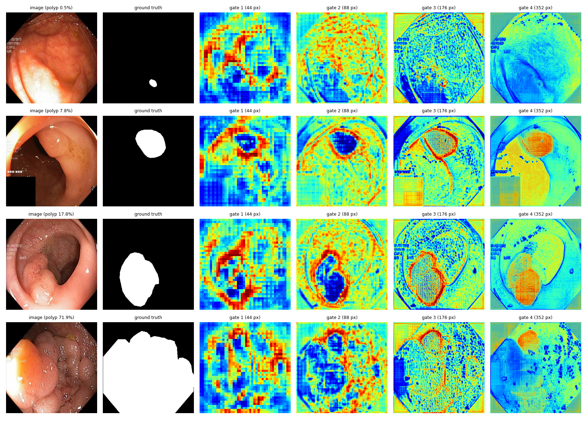
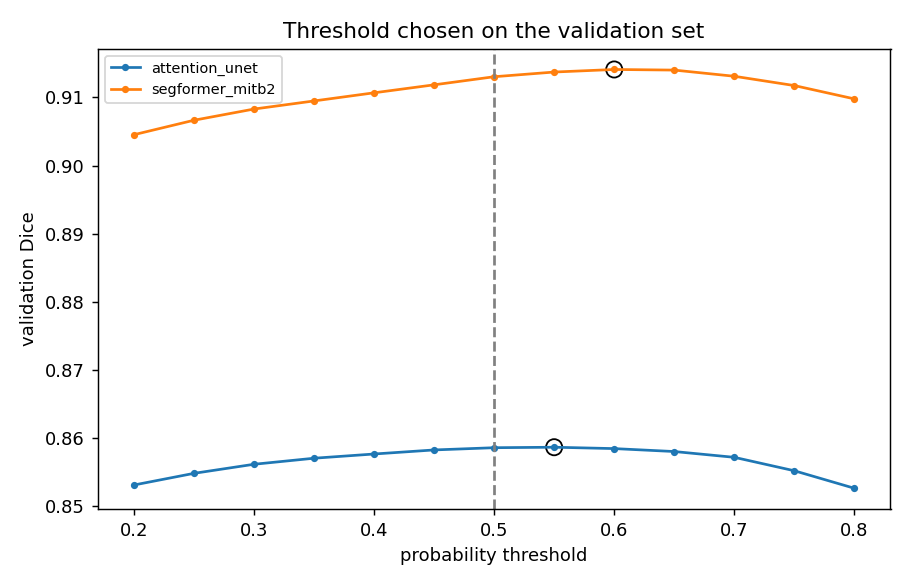

## 3.3 Attention U-Net

### Idea
A plain U-Net copies every encoder feature into the decoder through its skip connections, including
features from folds, glare, instruments and on-screen text. The Attention U-Net of Oktay et al. (2018)
adds an **attention gate** to each skip connection, which learns **where to look**: it gives every pixel
of the skip feature a weight between 0 and 1, so background is suppressed before the decoder uses it.

### Attention gate
For one skip connection, let
- **x** be the encoder skip feature map. It has fine resolution and knows *where* the edges are.
- **g** be the decoder feature map at the same resolution, just after upsampling. It comes from deeper in
  the network and carries the context of *what* a polyp looks like.

The gate computes one attention coefficient per pixel:

α = σ( ψ( ReLU( W_g·g + W_x·x ) ) ),    output = x · α

- **W_g** and **W_x** are 1×1 convolutions (each followed by batch normalisation) that project g and x
  into a shared space with half as many channels as x.
- Adding the two projections and applying ReLU keeps a location only where both the context (g) and the
  local detail (x) respond.
- **ψ** is a 1×1 convolution down to **one channel**, and **σ** is the sigmoid, so α ∈ [0, 1] at every pixel.
- The gated skip **x · α** replaces x in the concatenation. Pixels with α ≈ 0 contribute almost nothing.

### Where the gates sit
The network is **identical to the baseline U-Net** of Section 3.1 (64 → 1024 channels, trained from scratch,
BCE + Dice loss, AdamW, learning rate 3·10⁻⁴, 60 epochs, OneCycle schedule, seed 42). The only change is
one gate on each of the four skip connections, at **44×44, 88×88, 176×176 and 352×352 pixels** (gates 1 to 4,
from the deepest to the shallowest). The gates add only 0.35 M parameters (31.4 M in total, +1.1%), so any
difference from the baseline comes from the gates themselves.

Training took 54 minutes on an NVIDIA T4. The best validation Dice, 0.859, was reached at epoch 47.

### Result
On the test set the Attention U-Net reaches a **Dice of 0.854** and an **IoU of 0.775**
(precision 0.868, recall 0.895), against 0.851 / 0.774 for the baseline. The gain of **+0.003 Dice is
too small to be meaningful** from a single training run. With test-time augmentation it scores 0.857 (baseline 0.863), and on the unseen
CVC-ClinicDB data 0.741 (baseline 0.750). **On Kvasir-SEG, attention gates do not measurably improve a U-Net
trained from scratch.** A likely reason is that the baseline already learns to ignore most background through
its decoder, and 800 training images are not enough for the extra gating to pay off.

### Attention maps
Figure `figures/attention_maps.png` shows α for each gate on four test images, ordered from the smallest
polyp (0.5% of the image) to the largest (71.9%). Red means α close to 1 and blue means α close to 0.

- **Gate 1 (44 px)** is coarse and noisy. At this depth α marks broad regions rather than the polyp.
- **Gates 2 and 3 (88 and 176 px)** trace the **polyp boundary**: for the 7.8% and 17.8% polyps they draw a
  clear ring around the lesion. They mostly pass edge information, which is what the skip connections are
  for.
- **Gate 4 (352 px)** highlights the **polyp body** of the medium polyps and keeps much of the background low.
- **Where the gates help and where they hurt.** The per-image test Dice of these images shows both sides:
  - For the **tiny 0.5% polyp**, the maps are diffuse, but gate 3 shows a small ring at the lesion. The
    Attention U-Net reaches a Dice of **0.593 against 0.129** for the baseline, its clearest gain.
  - For the **71.9% polyp**, the gates highlight only part of it, because a lesion that fills the frame looks
    like background tissue. Dice falls to **0.573 against 0.781** for the baseline.
  - The gates also respond to **on-screen text and the black overlay box** in the corner. These artefacts are
    common in Kvasir-SEG, and α does not learn to ignore them.

These opposite effects on small and very large polyps largely cancel out, which explains why the average
Dice barely changes.

## 3.4 SegFormer (MiT-B2 transformer encoder)

### Encoder: hierarchical transformer
SegFormer (Xie et al., 2021) replaces the convolutional encoder with a **Mix Transformer (MiT-B2)**.
- The image is cut into **overlapping patches** (a strided convolution), so neighbouring patches share pixels.
  Positional information comes from **Mix-FFN**, a 3×3 depthwise convolution inside each feed-forward layer,
  so no positional embedding is needed and the model works at any input size.
- Each transformer block applies **self-attention**: every patch compares itself with every other patch and
  takes a weighted average of them. Every location can therefore use the **whole image as context**, while a
  CNN only sees a local window that grows slowly with depth. To keep this affordable at high resolution,
  MiT uses *efficient* self-attention, which shrinks the keys and values by a fixed ratio.
- Four stages produce features at **1/4, 1/8, 1/16 and 1/32** of the input size (88, 44, 22 and 11 pixels for
  a 352×352 image), a multi-scale pyramid like a CNN's.

### Decoder: all-MLP
The decoder is deliberately light. Each of the four feature maps is projected to the same number of channels
by an MLP (a 1×1 convolution), upsampled to 1/4 resolution, concatenated, fused by one more MLP, and mapped to
one logit per pixel. The prediction is made at **88×88**, and the segmentation head **bilinearly upsamples** it
×4 to 352×352 before the loss and metrics. (Our `Resize` wrapper would resize any other output to the input
size, but here it is only a safety net and never changes the output.)

### Training setup
- Encoder initialised with **ImageNet-pretrained** MiT-B2 weights (`segmentation-models-pytorch` 0.6.0).
- The same loss, augmentation, split, batch size, optimiser and schedule as the U-Nets, except
  **40 epochs** and a **learning rate of 10⁻⁴**. Transformers are sensitive to large learning rates, which
  would destroy the pretrained weights.
- 24.7 M parameters. Training took only 12 minutes on an NVIDIA T4. The best validation Dice, 0.913, was
  reached at epoch 23.

### Result
SegFormer is the strongest model so far:
- **Dice 0.917** and **IoU 0.865** on the test set (precision 0.911, recall 0.943), **+0.066 Dice** over the
  baseline, with fewer parameters.
- 0.926 with test-time augmentation.
- **0.863 on CVC-ClinicDB**, against 0.750 for the baseline. The gap is largest on the unseen dataset, which
  suggests that global context and ImageNet pretraining help the model generalise to a new hospital.

## 3.5 Threshold tuning

The models output a probability per pixel, and by default a pixel is called "polyp" when p > 0.5.
That value is a convention, not necessarily the best choice. We tune it as follows:

1. On the **validation set only**, compute the mean Dice for the thresholds 0.20, 0.25, …, 0.80.
2. Keep the threshold with the highest validation Dice (`thr_val`).
3. Apply it **once** to the test set (`dice_tuned`).

Choosing the threshold on the test set would leak test information into the model and over-state the score.
The test set must stay unseen until the final evaluation.

| Model | Best threshold (val) | Test Dice at 0.5 | Test Dice tuned | Gain |
|---|---|---|---|---|
| U-Net baseline | 0.50 | 0.851 | 0.851 | 0.000 |
| Attention U-Net | 0.55 | 0.854 | 0.854 | +0.0007 |
| SegFormer MiT-B2 | 0.60 | 0.917 | 0.918 | +0.0008 |

Both curves in `figures/threshold_curve.png` are **flat around 0.5**: between 0.4 and 0.7, validation Dice
varies by only 0.0015 for the Attention U-Net and 0.0034 for SegFormer. The chosen thresholds sit just above
0.5, so the models are slightly better when they mark a pixel as polyp only when they are a little more
confident. The gain is **about +0.001 Dice (+0.0007 and +0.0008)**, so threshold tuning is not a meaningful
source of improvement here.

The flat curves show instead that the models' predictions are **confident (sharp)**: most pixels are
predicted close to 0 or 1. On the test set, only **3.0%** (Attention U-Net) and **2.2%** (SegFormer) of
pixels have a probability between 0.2 and 0.8, so moving the threshold changes very few of them, and the
default of 0.5 is a safe choice. This is not the same as *calibration*, which would mean that pixels
predicted at, say, 0.8 are polyp 80% of the time. We did not measure calibration.
